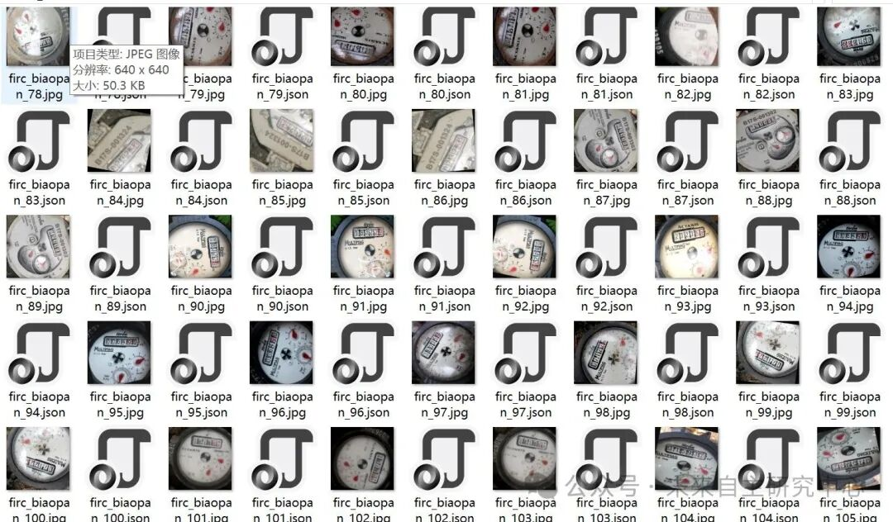
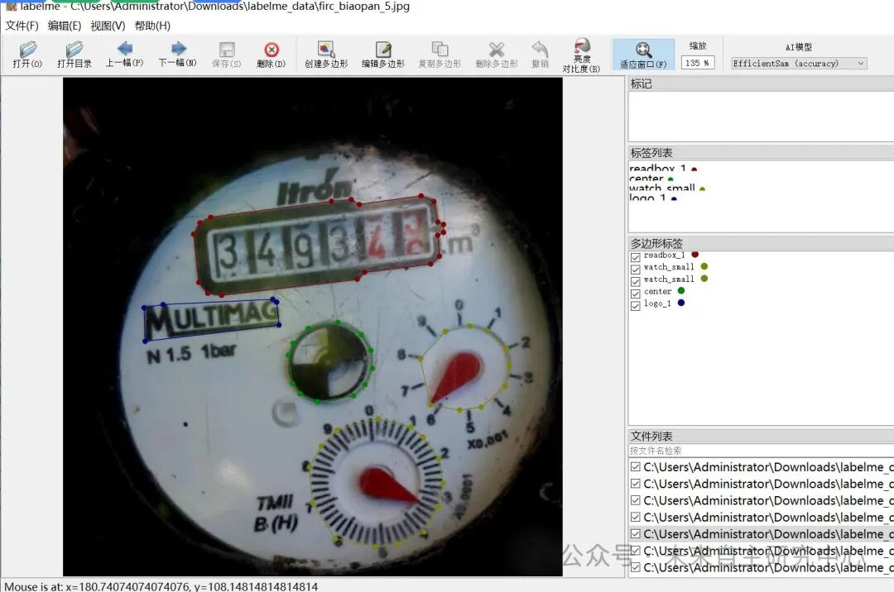

# Water Meter Number Display Dataset in labelme format with 3023 images across 13 categories

Dataset format: labelme format (without mask files, only including jpg images and corresponding json files)

Number of images (number of jpg files): 3023

Number of annotations (number of json files): 3023

Label category count: 13

Label category names: ["readbox_1", "center", "watch_small", "logo_1", "readbox_2", "logo_2", "logo_5", "readbox_3", "readbox_4", "readbox_6", "readbox_5", "logo_55", "logo1"]

Number of boxes labeled in each category:

readbox_1 count = 1208

center count = 2527

watch_small count = 5203

logo_1 count = 1079

readbox_2 count = 450

logo_2 count = 82

logo_5 count = 178

readbox_3 count = 648

readbox_4 count = 87

readbox_6 count = 3

readbox_5 count = 622

logo_55 count = 167

logo1 count = 3

Using labeling tool: labelme=5.5.0

Annotation rules: Draw polygons around the categories.

Important Notice: The dataset can be opened and edited using LabelMe. For JSON datasets, one must convert them into mask or Yolo formats for semantic segmentation or instance segmentation.

Special : This dataset does not guarantee the accuracy or precision of the trained models or weight files. The dataset is provided with accurate and reasonable annotations only.

Image Preview:

Annotation example:

## Payment

Here is a pay link on Stripe ( https://buy.stripe.com/3cs8yP7sY87d0vu9AB ). Please contact me lonlonago@foxmail.com after funding $89, and I will send you a complete data files , thank you!

